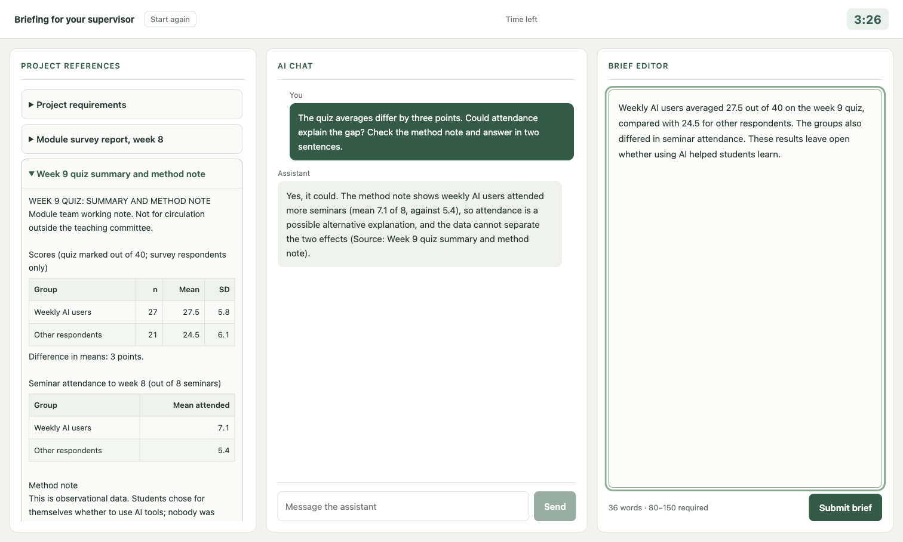
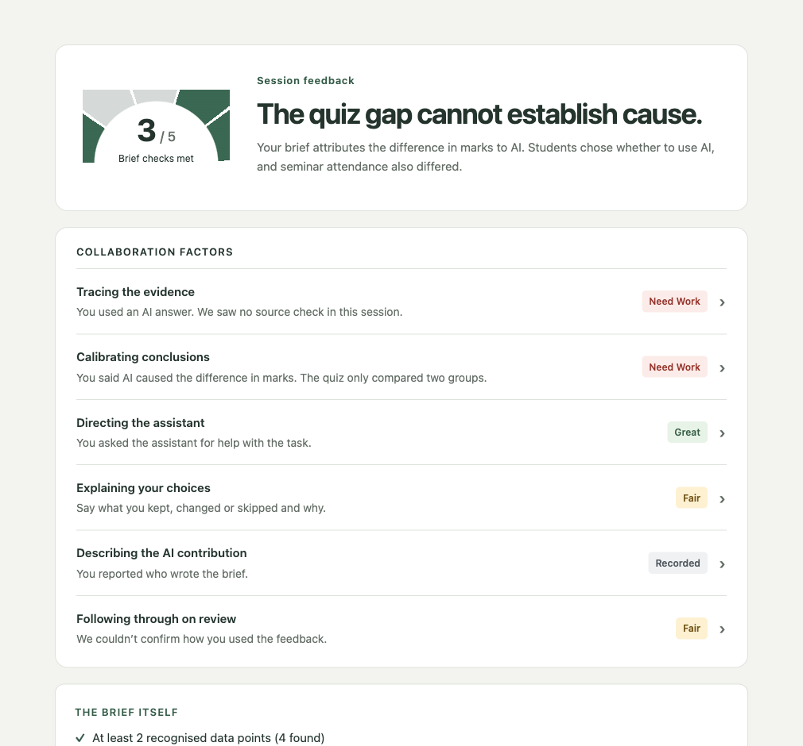

# AI Literacy Check

A student has one paragraph to answer a teaching committee’s question: does using AI help students learn? They can ask an AI research assistant for help and check its answers against a fictional survey, quiz report and reading list. Both the student and the assistant have the source pack.

Built for Reply Student Tech Clash, **AI on Campus · Track A**.

## Try the activity

- **Quick version:** Spend up to 4 minutes writing an 80–150 word brief. Submit it, report your confidence and say who wrote most of the wording.
- **Full version:** Get 8 minutes for the same brief, then answer up to two follow-up questions. The next question or hint depends on your answer. A teacher can review disputed feedback.

## A student’s walkthrough



1. **Read the sources.** The week 9 quiz note reports a three-point gap between groups. It also shows that weekly AI users attended more seminars.
2. **Ask a focused question.** Try “Could attendance explain the gap?” The assistant already has the documents, so you can go straight to the question.
3. **Make a decision.** Write the comparison in your own words and explain why it cannot establish that AI caused higher marks. Include two sourced data points and one student view in the finished brief.

## Reading the feedback



The example above comes from a different session. The student used figures from the assistant and concluded that AI improved learning. The report flags the missing source check and explains why comparing two groups cannot establish cause. Expand a row to see its criteria and a next step. The dial counts completed brief requirements, such as naming sources and staying within the word limit. There is no overall score or ranking.

In the full version, a follow-up might ask how you checked a percentage. If the denominator is unclear, the next question can offer a hint. The report shows what you demonstrated with that support alongside the original task feedback.

## Run locally

Use **Node.js 22.13 or later** for built-in SQLite. From the repository root:

```sh
npm install
cp -n .env.example .env.local
```

Set `ANTHROPIC_API_KEY` in `.env.local` for live chat and feedback. To enable teacher review, also set `OPS_REVIEW_KEY`. Start the app:

```sh
npm run dev
```

Open the [student activity](http://localhost:3000) or the [teacher dashboard](http://localhost:3000/ops). Run `npm test` and `npm run typecheck` to check a change.

## Data and design

The app uses Next.js, TypeScript, SQLite and the Anthropic API. The AI receives redacted session text. Students choose whether to store their work. If they opt out, the app clears their chat, brief and written follow-up answers when they finish and keeps the structured feedback.

The [scenario and source pack](data/scenario.json) contain the fictional teaching materials. The [design notes](docs/) document the earlier controlled activity and its scoring rationale.

The [three-layer assessment framework](docs/05_three_layer_framework.md) explains how the evidence fits together. In the live activity, chat and editing show how students use AI, and follow-up questions explore decisions the logs cannot explain. An earlier controlled scenario gave everyone the same claims to check. Only standardised tasks scored by shared rules can support comparisons between students.
