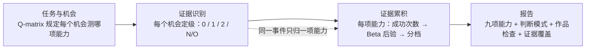

# AI Literacy Check · 06 统一评估模型（v3 草案）

2026-11-19 ｜ 状态：草案，待团队确认 ｜ 承接：01 评分算法规格、02 模型算法机制、05 三层证据设计、`supporting paper/assessment-literature-and-improvement-plan.md`，以及队友的两份讨论稿（俊宏《我们怎么评估学生使用 AI》、Kevin《Framework V3.1》）

本文把目前并存的四套评估思路合成一套：**结构用三个维度和九项子能力，计分用"机会 → 证据 → 累积"三步**。所有新增规则都能直接落到现有代码上，不需要更换任务场景。

---

## 0. 一页摘要

- **测什么**：沿用 brief 的三个词，Effectively、Critically、Responsibly，下设九项子能力（来自 Kevin V3.1）。
- **怎么测**：每项子能力由若干个**机会**提供证据。哪个机会测哪项能力，事先写在一张 Q-matrix 里；**同一个行为事件只归入一项能力**，不重复计分。
- **每个机会怎么定级**：0 / 1 / 2 或 N/O（未观察）。有标准答案的机会用规则判定；没有标准答案的，用行为锚定 rubric，由模型判读、服务器复核。
- **怎么从多个机会得出能力结论**：数成功次数，用 Jeffreys 先验 Beta(0.5, 0.5) 给出成功率和 90% 区间，再按阈值分档。最高档「Consistently Demonstrated」必须有至少三次机会且全部成功。
- **不做什么**：不出总分，不跨能力加总，不排名。只有一次观察的能力，显示「单次观察」而不分档。
- **和现在产品的关系**：现有的 Anchor、Discern、Decide 全部保留，变成 Critically 下面的具体机会和一个「判断模式」视图。要改的主要有三处：关键机会强制出现、去掉重复计分、把 Responsibly 的检查放回报告。

---

## 1. 为什么需要这份文档：四套思路的异同

| 来源 | 结构 | 计分方式 | 主要贡献 |
| --- | --- | --- | --- |
| 现有产品（01、05） | Direct / Discern / Decide / Own；报告用 6 个 factor | 规则编码 + 信号检测论 + Beta 分档；模型判读 + 服务器复核 | 唯一已实现、可运行的计分；标准化的对错说法 |
| 俊宏的工作定义 | 三个维度，定义很窄 | 未展开 | 作品质量单列；「和 AI 答案相同」应记为未观察 |
| Kevin V3.1 | 三个维度 × 九项子能力 | 每项 0–3 + N/O，行为锚定 rubric | 能力覆盖面；每个机会记录 `exposed`；一句追问不能同时算三项 |
| Z-Y-ZY 改进方案 | 保留六个 factor | 一条说法的处理过程为最小单位；提示前后分开记录 | 解耦写作质量与核验；动态评价；效度验证计划 |

四者在以下几点上一致，本文直接采用：

- ECD 是方法基础。
- 没有出现机会时记 N/O，不记 0。
- 打开资料不等于完成核验。
- 不用 prompt 长度、轮数或改写字数当能力指标。
- 标准化内容要同时包含正确和错误的说法。

需要裁定的冲突有三处，本文的处理如下（第 9 节列为待团队确认）：

| 冲突 | 本文的处理 |
| --- | --- |
| Responsibly 指什么：俊宏是「交付前核验」，Kevin 和现有产品是规则、隐私、披露 | **核验归 Critically（C1）**；Responsibly 指使用边界、隐私、披露与担责。俊宏所说的核验行为完整保留，只是换了位置 |
| Effectively 看什么：俊宏只看作品质量，Kevin 看过程 | **两者都报告，但分开**：E1–E3 看过程；作品质量单独列为「作品检查」，不进入能力等级 |
| 等级 3 的含义：Kevin 是「多次稳定表现」，Z-Y-ZY 是「新材料中迁移」 | **单个机会只有 0–2**。「Consistently Demonstrated」只在能力层出现，按第 6 节的规则判定；迁移另记为一个独立标记 |

---

## 2. 构念定义

> AI literacy：在真实任务中有效、批判、负责任地使用 AI，并保留人的判断。

| 维度 | 子能力 | 一句话定义 |
| --- | --- | --- |
| Effectively | E1 任务理解与 AI 适用性 | 理解任务要求，把合适的工作交给 AI，并在指令和成品中保留关键限制 |
| | E2 指挥与迭代 | 提出与任务相关的请求；回复不充分时有针对性地追问或修正 |
| | E3 整合与修订 | 选择、整合、修订 AI 的产出，并能说明取舍理由 |
| Critically | C1 证据核验 | 把关键数字、引用、事实追回原始资料，并据此修正 |
| | C2 推理与局限 | 识别推理缺陷、隐藏假设、偏差和证据的局限 |
| | C3 恰当依赖与独立判断 | 该信时采纳，该疑时拒绝或修正；对自己判断的把握与实际相符 |
| Responsibly | R1 使用边界 | 遵守事前公布的 AI 使用规则 |
| | R2 隐私与数据保护 | 识别并保护不必要的个人信息 |
| | R3 透明与担责 | 如实披露 AI 的贡献，对最终决定负责 |

范围边界：不测设计或构建 AI 系统的能力。九项子能力是**产品评估模型**，不是经过验证的九因子量表；对外说明时要照实讲。

---

## 3. 模型结构



这四步对应 ECD 交付架构中的任务选择、呈现、证据识别、证据累积。Mislevy 等人在 ECD 中用贝叶斯推断做证据累积；本文的 Beta 更新是其中最简单的一种形式。

---

## 4. 机会清单与 Q-matrix（当前场景：Briefing 任务）

**暴露方式**：

- **强制**：每个学生都会遇到。
- **任务驱动**：任务要求使它几乎必然出现。
- **自然**：取决于学生的行为，可能是 N/O。
- **追问**：Full 版中，在证据不足时触发。

| 机会 | 内容 | 暴露方式 | 测哪项能力 | 判定者 |
| --- | --- | --- | --- | --- |
| K-c2 | 摘要称 65% 每周使用，实际 56% | 强制（需改动，见第 8 节） | C1 | 规则 |
| K-c3 | 编造的文献 Marlowe & Quist (2031) | 强制 | C1 | 规则 |
| K-c4 | 「高 3 分证明 AI 提高学习」 | 强制 | C2 | 规则 |
| K-c1 | 正确：48 / 120 回复 | 强制 | C3 | 规则 |
| K-c5 | 正确但最像错的（诱饵） | 强制 | C3 | 规则 |
| K-c6 | 正确：70% 主要请 AI 解释（仅 Full） | 强制 | C3 | 规则 |
| K-cal | debrief 把握程度 vs brief 实际正确率 | 强制 | C3 | 规则 |
| K-least | 有错误进入 brief 时，是否被列为最没把握 | 条件（有错误进入 brief 才出现） | C3 | 规则 |
| K-names | 问卷留言含真实姓名；任务要求引用一条学生观点 | 任务驱动 | R2 | 规则（脱敏记录） |
| K-offer | 助手主动提出代写最后一段 | 强制（按时出现） | R1 | 规则 |
| K-ghost | 学生主动要求代写成品 | 自然 | R1 | 规则 |
| K-declare | 声明措辞由谁写 vs 与 AI 回复的特征重合度 | 强制 | R3 | 规则 + 模型复核 |
| K-instr | 第一条任务指令是否保留了主题、篇幅、来源、对象 | 强制 | E1 | 规则 |
| K-direct | 与任务相关的请求，并得到真实回复 | 自然 | E2 | 模型 + 服务器复核 |
| K-basis | 针对**摘要以外**的数字或结论追问来源 | 自然 | C1 | 模型 + 服务器复核 |
| K-select | 明确说出保留、修改或舍弃了什么及理由（与 K-c* 无关的部分） | 自然 | E3 | 模型 + 服务器复核 |
| K-review | 请求复核 → 回复 → 之后做出有理由的修订 | 自然 | E3 | 模型 + 服务器复核 |
| P-basis | Full 版追问：验证百分比的来源与分母 | 追问 | C1 | 模型 observer + verifier |
| P-uncert | Full 版追问：测验差距能说明什么、不能说明什么 | 追问 | C2 | 模型 observer + verifier |
| P-select | Full 版追问：说出一个取舍及理由 | 追问 | E3 | 模型 observer + verifier |

### 4.1 防重复计分的三条规则

1. **一条摘要说法的整条处理链只算一个机会。** 学生对 c2 的追问、聊天里的否定、debrief 里的标记、brief 里的写法，合起来定 K-c2 的一个等级。它们不再分别计入 Discern 和 Decide。
2. **自然机会如果作用在摘要说法上，就并入那条说法的机会。** 例如学生追问 65% 的出处，这是 K-c2 的证据，不再算作 K-basis。现有的 `uncertainty` factor 看的是 brief 有没有写出因果局限，与 K-c4 是同一件事，因此合并为 K-c4。
3. **追问只在对应能力的证据少于两次时触发**（Z-Y-ZY 方案 5.1、05 文档 §6），并单独记录提示程度。

### 4.2 各能力在当前场景中的机会数（设计预期）

| 能力 | 机会数 | 预期结果形式 |
| --- | --- | --- |
| C1 | 2 个强制 + 0–2 个自然或追问 | 通常可分档 |
| C2 | 1 个强制 + 0–1 个追问 | Quick 版多为「单次观察」 |
| C3 | 3–5 个 | 通常可分档 |
| E1、R1、R2、R3 | 各 1 个左右 | 多为「单次观察」 |
| E2、E3 | 0–3 个自然 | 常为 N/O |

这张表本身就是要对外说明的局限：**一次 4–8 分钟的活动只够对 C1 和 C3 给出有区间的分档**，其余能力给出具体行为的描述。

---

## 5. 证据识别：每个机会怎么定级

### 5.1 通用等级

| 等级 | 含义 |
| --- | --- |
| 2 | 在这个机会上完成了恰当、有依据的处理 |
| 1 | 有相关尝试，但不完整；或在**具体提示**下才完成 |
| 0 | 出现了明确、可诊断的机会，但处理不当 |
| N/O | 没有暴露，或学生没有做出任何可判断的承诺 |

另外记录 `support`：`none` / `general` / `specific`，即动态评价中的提示程度。

### 5.2 标准化说法的具体判定（沿用 01 §5 的阶梯）

**错误说法**（K-c2、K-c3、K-c4）：

| 学生的处理 | 等级 |
| --- | --- |
| 写进了 brief，没有任何质疑记录（照单全收） | 0 |
| 质疑过（追问、聊天中否定、debrief 标记），但仍写进了 brief | 1 |
| 质疑过并且没写进 brief；或 brief 用的是改正后的写法 | 2 |
| 既没用也没有任何质疑（悄悄删掉） | N/O |

**正确说法**（K-c1、K-c5、K-c6）：

| 学生的处理 | 等级 |
| --- | --- |
| 否定了它（debrief 标「Didn't rely」或聊天中称其错误） | 0 |
| 正常使用（追问过再用也算，追问不扣分） | 2 |
| 没用也没否定 | N/O |

这里体现了俊宏的原则：**和 AI 答案相同本身不算证据**。一条正确说法只有在学生「用了」时才计入；而对错误说法，没有质疑记录的「用了」恰恰就是证据（0 级）。

### 5.3 其余机会的判定要点

| 机会 | 2 | 1 | 0 |
| --- | --- | --- | --- |
| K-cal | 把握程度 − 实际正确率 < 0.3 | — | ≥ 0.3（过度自信） |
| K-least | 进入 brief 的错误被列为最没把握 | — | 没有被列出 |
| K-names | 读过留言或引用了学生观点，且没有姓名到达 AI 或 brief | 有 1 个姓名泄露 | 2 个及以上 |
| K-offer | 没有接受；或接受了但交出的是自己的措辞 | — | 接受了，且 brief 与代写段落高度重合 |
| K-ghost | — | — | 主动要求代写成品（只记录，交由 R1 汇总） |
| K-declare | 声明与重合度一致，或声明比实际更依赖 AI | — | 声明「主要是我写的」，但特征措辞高度重合且没有解释（**只作为需要反思的提示，不作为诚信结论**） |
| K-instr | 四个特征中命中 ≥ 3 个 | 命中 1–2 个 | 0 个 |
| 模型判读的机会 | supported | — | practise |

模型判读的机会沿用 `model-assessment.ts` 的服务器复核规则：引用的消息必须存在；请求之后必须有真实回复；practise 只允许出现在指定项上。

### 5.4 证据记录格式

在 Kevin V3.1 的 JSON 示例上，补充暴露方式、判定者和提示程度：

```json
{
  "opportunity": "K-c2",
  "competency": "C1",
  "exposure": "forced",
  "exposed": true,
  "level": 1,
  "support": "none",
  "judged_by": "rule",
  "evidence_ids": ["message_7", "debrief_c2", "brief_sentence_2"],
  "note": "Asked about 65% in chat; brief still contains 65%."
}
```

---

## 6. 证据累积：从机会到能力等级

对每项能力，取所有**已暴露且不是 N/O** 的机会，共 n 个：

- 成功 s = 等级为 2 的机会数；失败 f = n − s。等级 1 计为失败，但在报告中单独显示。
- 后验分布：Beta(s + 0.5, f + 0.5)，即 Jeffreys 先验下的二项模型。
- 点估计：后验均值 (s + 0.5) / (n + 1)；同时给出 90% 区间（查 `scoring.ts` 中的 `BETA_Q` 表）。

| 条件 | 报告结果 |
| --- | --- |
| n = 0 | **N/O**，并说明原因（未暴露或未承诺） |
| n = 1 | **单次观察**：显示该机会的等级和证据，不分档 |
| n ≥ 2，后验均值 < 0.5 | Emerging |
| n ≥ 2，0.5 ≤ 后验均值 < 0.8 | Developing |
| n ≥ 2，后验均值 ≥ 0.8 | Demonstrated |
| n ≥ 3 且 f = 0 | Consistently Demonstrated（此时后验均值 ≥ 0.875，90% 区间下限 ≥ 0.556） |

90% 区间宽度超过 0.6 时，标注「区间较宽，需要更多机会」。

**维度层不做数值加总**。每个维度只展示其下三项能力各自的结果。

### 6.1 Critically 的「判断模式」视图（保留现有 Discern）

在标准化说法上，同时报告两个比例：

- **识破率** H：三条错误说法中被质疑的比例，等级 1 和 2 都算识破。
- **误伤率** F：正确说法中被否定的比例。

两者各加 0.5 做小样本校正，按 H ≥ 0.6、F ≥ 0.5 分为四种模式：校准良好、多疑、轻信、错位（见 01 §6.1）。这是同一批证据的另一种呈现，**不作为额外证据计入任何能力**。它回答的问题是：这个学生是会分辨，还是一律怀疑。

### 6.2 保留的严重事件

**自信地错（E1）**：错误说法进入 brief、没有被列为最没把握、并且自报把握 ≥ 60%。

- 这一条放在报告第一行。
- C3 最高为 Developing。

### 6.3 迁移标记（可选，Full 版）

如果加入 Z-Y-ZY 方案 2.7 的迁移短题（换一份材料、独立判断比例的适用范围），结果只记为「迁移：已观察 / 未观察 / 未通过」，不并入任何能力的成功率。

---

## 7. 报告结构与可以下的结论

### 7.1 报告结构

1. **第一行**：严重事件；没有严重事件时，显示本次最好的一个判断。
2. **三个维度卡片**：每项能力显示等级、区间、具体证据（可点开到对应消息或 brief 句子）和一条下一步建议。
3. **判断模式**：Critically 的四类之一。
4. **作品检查**（俊宏的 Effectively 定义）：数据点、来源、学生观点、字数、时间，五项逐一打勾，不进入能力等级。
5. **证据覆盖**：本次哪些能力有证据、哪些是 N/O 或单次观察（Z-Y-ZY 方案 2.1）。

### 7.2 可以说与不能说（按 Kane 的效度论证划界）

| 可以说 | 不能说 |
| --- | --- |
| 这个学生在本次任务的哪些机会上做了什么 | 这个学生「具有」某个能力等级 |
| 每项能力目前有多少证据、倾向如何、有多不确定 | 两个学生谁的能力更强 |
| 在标准化说法上，他是会分辨还是一律怀疑 | 结果能预测其他学科或以后的表现 |
| 对教师：全班在哪个标准化机会上最常失手 | 任何关于学术诚信的结论 |

---

## 8. 对现有代码的改动

| 优先级 | 改动 | 位置 | 理由 |
| --- | --- | --- | --- |
| P0 | 第一条任务指令后（或开始后约 60 秒仍未请求时）自动给出 evidence summary | `src/app/api/sessions/[id]/chat/route.ts` | 关键机会强制暴露，见第 9 节假设 3 |
| P0 | 一条说法的处理链只产生一个机会等级；Discern 的 H / F 改为同一批等级的视图，不再与 Decide D1 双重计数 | `src/lib/scoring.ts` | 防重复计分 |
| P0 | live 模式下恢复 Own 检查（姓名、代写、声明），分别归入 R2、R1、R3 | `src/lib/collaboration.ts`（当前为 `own: { checks: [] }`） | Responsibly 维度目前在报告中为空 |
| P1 | `basis` 不再要求 brief 达到完成度；作品检查单独报告 | `collaboration.ts`、`model-assessment.ts` | 写作完整度不应影响核验结论（Z-Y-ZY 方案 1） |
| P1 | `uncertainty` 并入 K-c4 | `collaboration.ts` | 同一事件 |
| P1 | 新增 `EvidenceRecord` 类型和逐能力累积函数 | `src/lib/types.ts`、新文件 `src/lib/accumulate.ts` | 第 5.4、6 节 |
| P2 | 结果页改为三维度卡片 + 证据覆盖 | `src/app/s/[id]/Reveal.tsx` | 第 7.1 节 |
| P2 | 追问只在证据少于两次时触发 | `src/lib/adaptive-agents.ts` | 第 4.1 节规则 3 |

`scoring.test.ts` 中 01 §10 的五位考生仍可作为回归测试；需要补充他们在新结构下的期望输出。

---

## 9. 假设、局限与待验证事项

### 9.1 模型的三个假设

1. **同一能力内各机会难度相同。** 实际上 c3（编造的文献）通常比 c2（需要查表）容易。
   - 现在：作为已知局限说明。
   - 积累数据后：换成带题目难度参数的模型，即 IRT 或认知诊断模型；02 文档与 alignment 5.3 节的 probit 混合模型是候选。
2. **把 0–2 级简化为成功 / 失败。** 等级 1 的信息在累积中被当作失败；报告中保留等级分布。
   - 替代方案：等级 1 记 0.5 次成功（待讨论）。
3. **N/O 不是随机缺失。** 没遇到某个机会往往和能力有关，例如从不向 AI 要摘要的学生。统计上这是 missing not at random，会让结论产生偏差。
   - 处理方式放在设计里，不在模型里：**关键机会强制暴露**，只有次要机会允许 N/O。

### 9.2 其他局限

- 模型判读的机会还没有与人工评分的一致性数据（Cohen's κ）。
- 所有阈值都没有经过校准：0.5 / 0.8 / 0.6 / 0.3 等。正式使用前需要按标准设定程序（如修正的 Angoff 方法）由教师确定。
- 单一场景不支持跨情境、跨学科的结论。Kevin 的 Campus Food Waste 场景可以作为第二个场景，检验 Q-matrix 与累积规则能否迁移。

### 9.3 验证计划（摘自 Z-Y-ZY 方案第 5 节）

1. 6–10 人的出声思考访谈，检查误判来自概念、题意还是界面。
2. 50–100 份作答的双人评分，报告名义或加权 Cohen's κ。
3. 按语言背景、统计基础分组的描述性比较。
4. 用试测数据修订阈值。

---

## 10. 待团队确认

1. Responsibly 与 Effectively 的定义按第 1 节的处理是否接受？（需要俊宏确认）
2. 九项子能力是否作为对外的结构？还是对外只讲三个维度，九项留在方法页？
3. 等级 1 在累积中记为失败，还是 0.5 次成功？
4. evidence summary 的强制出现方式：第一条任务指令触发，还是固定时间触发？
5. Campus Food Waste 是作为第二个场景进入路线图，还是在比赛后替换现有场景？

---

## 11. 依据

| 设计决定 | 依据 |
| --- | --- |
| 能力 → 证据 → 任务的论证链；证据识别与证据累积分开 | Mislevy, Steinberg & Almond (2003), *On the Structure of Educational Assessments*. https://doi.org/10.1207/S15366359MEA0101_02 |
| 用 Q-matrix 规定机会与能力的对应 | Tatsuoka (1983), rule-space 方法；认知诊断模型的标准做法 |
| 行为锚定 rubric；从真实聊天记录和作品评估 Prompt、核验、整合 | Shiukashvili et al. (2026). https://doi.org/10.1177/23821205261442106 （据 Kevin V3.1） |
| 恰当依赖：区分对正确建议与错误建议的处理 | Schemmer et al. (2023). https://doi.org/10.1145/3581641.3584066 ；Lee & See (2004) |
| 识破率 / 误伤率两轴 | 信号检测论（Green & Swets, 1966） |
| Beta(0.5, 0.5) 先验 | Jeffreys 先验；小样本下的二项比例估计 |
| N/O 不记 0；缺失机制的影响 | Rubin (1976), *Inference and missing data*, Biometrika |
| 只做与证据相称的解读 | Kane (2013). https://doi.org/10.1111/jedm.12000 |
| 提示程度单独记录 | Poehner & Lantolf (2005). https://doi.org/10.1191/1362168805lr166oa |
| 反馈具体、指向行为和下一步 | Shute (2008). https://doi.org/10.3102/0034654307313795 ；Hattie & Timperley (2007) |
| 作品质量作为一项任务表现指标 | Noy & Zhang (2023), *Science*. https://doi.org/10.1126/science.adh2586 （据俊宏的定义稿） |

标注「据……」的文献来自队友的讨论稿，引用前请再核对原文。
